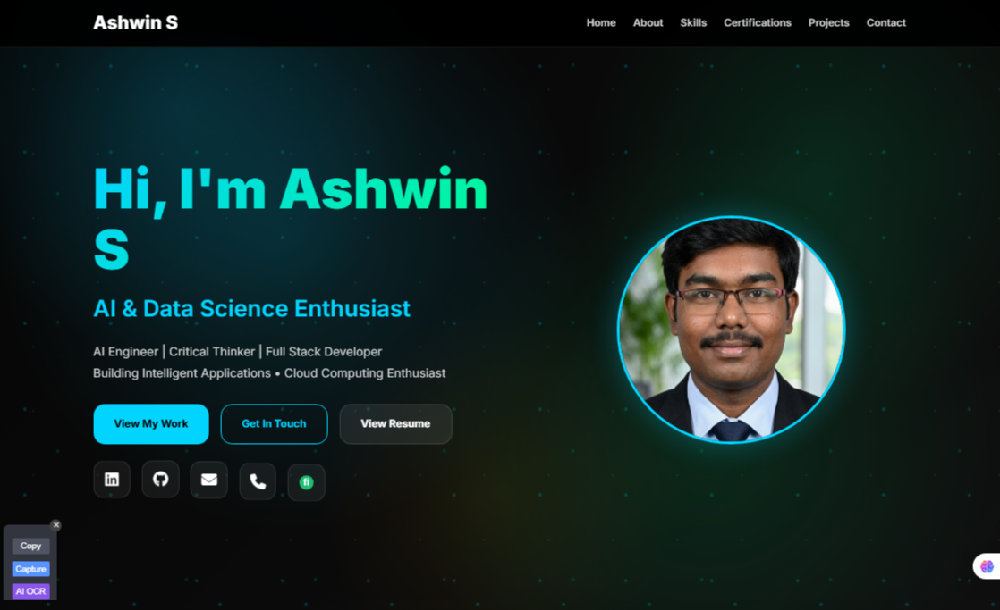

<div align="center">

# 🚀 Ashwin S — Full Stack Developer Portfolio

### Production-Ready Portfolio built with React, Node.js, Express & Supabase

A modern full-stack portfolio application showcasing my projects, skills, certifications, achievements and contact workflow.

<br/>

<a href="https://ashwinweb-dev.vercel.app">

</a>

<a href="https://github.com/ASHWIN07026">

</a>

<a href="https://www.linkedin.com/in/ashwin-s-650b48329">

</a>

</div>

---

## 🖥️ Portfolio Preview

<div align="center">

<a href="https://ashwinweb-dev.vercel.app">

</a>

<br/><br/>

<a href="https://ashwinweb-dev.vercel.app">

</a>

<p>
<b>Click the preview or button above to explore the live application.</b>
</p>

</div>

---

## 📌 Project Overview

This project is a **full-stack developer portfolio platform** designed to present my technical skills, projects, certifications, achievements and contact information through a professional and interactive web application.

Unlike a traditional static portfolio, this application demonstrates practical experience across the complete web-development lifecycle:

- ⚛️ React frontend development
- ⚙️ Node.js and Express backend development
- 🔗 REST API integration
- 🗄️ Supabase PostgreSQL database
- 📬 Contact-form processing
- ✉️ EmailJS notifications
- 📱 Responsive web design
- 🔐 Environment-based configuration
- ☁️ Cloud deployment

The application was originally built as part of my **Web Development Internship at Thiranex** and later expanded into a production-style full-stack portfolio project.

---

## 📊 Project Status

| Component | Status |
|---|---|
| 🌐 Frontend | ✅ Deployed on Vercel |
| ⚙️ Backend | ✅ Deployed on Render |
| 🗄️ Database | ✅ Supabase PostgreSQL |
| 📬 Contact Form | ✅ Implemented |
| ✉️ Email Notifications | ✅ EmailJS |
| 📱 Responsive UI | ✅ Desktop / Tablet / Mobile |
| 🔐 Environment Configuration | ✅ Environment Variables |

---

## 🎯 Problem Statement

Traditional resumes and static portfolio pages provide limited opportunities to demonstrate practical software-engineering skills.

A developer may list technologies such as React, Node.js, APIs and databases on a resume, but recruiters cannot immediately see how those technologies were combined into a working application.

This project addresses that limitation by turning the portfolio itself into a **full-stack software project** demonstrating:

- frontend development
- backend API development
- database integration
- responsive UI design
- third-party service integration
- environment configuration
- cloud deployment

---

## 💡 Solution

The portfolio uses a modern full-stack architecture connecting the user interface, backend API, database and notification services.

```text
User
  │
  ▼
React + Vite Frontend
  │
  │ REST API
  ▼
Node.js + Express Backend
  │
  ├──────────────► Supabase PostgreSQL
  │
  └──────────────► EmailJS Notifications
```

### Deployment Architecture

```text
Frontend  → Vercel
Backend   → Render
Database  → Supabase PostgreSQL
Email     → EmailJS
```

---

# ✨ Key Features

<table>
<tr>
<td width="50%" valign="top">

### 🎨 Frontend

- Responsive React interface
- Mobile, tablet and desktop support
- Modern dark-themed UI
- Animated visual effects
- Reusable React components
- Vite-powered development
- Responsive navigation
- Interactive portfolio sections

</td>

<td width="50%" valign="top">

### ⚙️ Backend

- Node.js server
- Express REST API
- Request processing
- CORS configuration
- Database connectivity
- Contact-form processing
- Environment-based configuration

</td>
</tr>

<tr>
<td width="50%" valign="top">

### 📬 Contact System

- Functional contact form
- Form validation
- Backend API integration
- Supabase data storage
- EmailJS notifications
- User feedback handling

</td>

<td width="50%" valign="top">

### ☁️ Deployment

- Vercel frontend hosting
- Render backend hosting
- Supabase cloud PostgreSQL
- Environment variables
- Production deployment
- GitHub source control

</td>
</tr>
</table>

---

# 🛠️ Tech Stack

<div align="center">

### Frontend


<br/><br/>

### Backend


<br/><br/>

### Database & Cloud


<br/><br/>

### Development Tools


</div>

<br/>

| Layer | Technology | Purpose |
|---|---|---|
| Frontend | React.js | Component-based user interface |
| Build Tool | Vite | Fast development and optimized builds |
| Language | JavaScript | Frontend and backend programming |
| Styling | CSS3 | Responsive custom UI |
| Backend | Node.js | Server-side JavaScript runtime |
| API | Express.js | REST API development |
| Database | Supabase PostgreSQL | Persistent application data |
| Email | EmailJS | Contact email notifications |
| Frontend Hosting | Vercel | Production frontend deployment |
| Backend Hosting | Render | Backend/API deployment |
| Version Control | Git & GitHub | Source-code management |

---

# 🏗️ System Architecture

```text
┌─────────────────────────────────┐
│              USER               │
└────────────────┬────────────────┘
                 │
                 ▼
┌─────────────────────────────────┐
│       REACT + VITE FRONTEND     │
│                                 │
│  • Hero                         │
│  • About                        │
│  • Skills                       │
│  • Projects                     │
│  • Certifications              │
│  • Achievements                 │
│  • Contact                      │
└────────────────┬────────────────┘
                 │
                 │ REST API
                 ▼
┌─────────────────────────────────┐
│    NODE.JS + EXPRESS BACKEND    │
│                                 │
│  • API Routes                   │
│  • Request Processing           │
│  • Validation                   │
│  • CORS                         │
│  • Database Integration         │
└──────────┬───────────┬──────────┘
           │           │
           ▼           ▼
┌────────────────┐  ┌────────────────┐
│    SUPABASE    │  │    EMAILJS     │
│   PostgreSQL   │  │ Notifications  │
│                │  │                │
│ Contact Data   │  │ Contact Email  │
└────────────────┘  └────────────────┘
```

---

# 🔗 Contact Form Flow

```text
Visitor
   │
   ▼
Contact Form
   │
   ▼
Frontend Validation
   │
   ▼
Express REST API
   │
   ├──────────────► Supabase PostgreSQL
   │                 │
   │                 └─ Store Submission
   │
   └──────────────► EmailJS
                     │
                     └─ Send Notification
```

This flow demonstrates **frontend-to-backend communication, API handling, database persistence and third-party service integration**.

---

# 📁 Project Structure

```text
Ashwinweb-dev/
│
├── Frontend/
│   ├── public/
│   │   └── favicon.svg
│   │
│   ├── src/
│   │   ├── components/
│   │   │   ├── Navbar.jsx
│   │   │   ├── Hero.jsx
│   │   │   ├── About.jsx
│   │   │   ├── Skills.jsx
│   │   │   ├── Projects.jsx
│   │   │   ├── Certifications.jsx
│   │   │   ├── Contact.jsx
│   │   │   └── Footer.jsx
│   │   │
│   │   ├── App.jsx
│   │   ├── main.jsx
│   │   ├── index.css
│   │   └── App.css
│   │
│   ├── index.html
│   ├── vite.config.js
│   └── package.json
│
├── Backend/
│   ├── index.js
│   └── package.json
│
├── docs/
│   └── portfolio-preview.png
│
├── .env.example
├── .gitignore
├── README.md
├── package.json
└── package-lock.json
```

> `.env` is intentionally excluded from the repository. Use `.env.example` as the configuration template.

---

# ⚡ Quick Start

## 1️⃣ Clone the Repository

```bash
git clone https://github.com/ASHWIN07026/Ashwinweb-dev.git
cd Ashwinweb-dev
```

## 2️⃣ Start the Frontend

```bash
cd Frontend
npm install
npm run dev
```

The frontend normally runs at:

```text
http://localhost:5173
```

## 3️⃣ Start the Backend

Open another terminal:

```bash
cd Backend
npm install
npm start
```

Configure the required environment variables before starting the backend.

---

# 🚀 Detailed Setup

## Prerequisites

Make sure you have:

- Node.js 18+
- npm
- Git
- Supabase account
- EmailJS account

---

## Frontend Installation

```bash
cd Frontend
npm install
npm run dev
```

For a production build:

```bash
npm run build
```

---

## Backend Installation

```bash
cd Backend
npm install
```

Create a local `.env` file using `.env.example` as the template.

Example:

```env
SUPABASE_URL=your_supabase_project_url
SUPABASE_KEY=your_supabase_key
PORT=5000
```

Then start the server:

```bash
npm start
```


# Environment Variables

# Supabase
SUPABASE_URL=your_supabase_project_url

SUPABASE_KEY=your_supabase_key

# Server
PORT=5000

---


# 🛡️ Security Notes

- `.env` files should be excluded through `.gitignore`
- Private credentials should never be committed to GitHub
- `.env.example` contains placeholder configuration only
- CORS controls allowed frontend origins
- Database configuration is managed through environment variables
- Production environment variables are configured in hosting dashboards
- Frontend and backend are separated into independent application layers

---

# 📧 EmailJS Configuration

The contact system uses EmailJS to deliver email notifications.

Example configuration:

```javascript
emailjs.sendForm(
  "YOUR_SERVICE_ID",
  "YOUR_TEMPLATE_ID",
  form.current,
  "YOUR_PUBLIC_KEY"
);
```

Replace the placeholder values with your own EmailJS configuration.

Do not publish credentials that should remain private.

---

# 🌐 Deployment

## ▲ Frontend — Vercel

The React frontend is deployed using **Vercel**.

### Live Application

**https://ashwinweb-dev.vercel.app**

Production build:

```bash
npm run build
```

---

## ⚙️ Backend — Render

The Node.js/Express backend is deployed using **Render**.

Typical configuration:

```text
Build Command:
npm install

Start Command:
node index.js
```

Required environment variables should be configured through the Render environment settings.

---

## 🗄️ Database — Supabase

Supabase provides the project's PostgreSQL database.

It is used for:

- PostgreSQL hosting
- persistent data storage
- contact-form submissions
- backend database integration

---

# 📱 Application Sections

| Section | Purpose |
|---|---|
| 🏠 Hero | Developer introduction and primary actions |
| 👨‍💻 About | Professional background |
| 🛠️ Skills | Technologies and development tools |
| 🚀 Projects | Software-development project showcase |
| 📜 Certifications | Certifications and technical learning |
| 🏆 Achievements | Technical achievements and activities |
| 📬 Contact | Visitor communication |
| 🔗 Footer | Navigation and social links |

---

# 📷 Screenshot

<div align="center">


<br/><br/>

<a href="https://ashwinweb-dev.vercel.app">

</a>

</div>

> The screenshot above shows the deployed portfolio application. For the complete interactive experience, use the live application.

---

# 🧠 Engineering Skills Demonstrated

<table>

<tr>
<td width="50%" valign="top">

### Frontend Engineering

- React component development
- Responsive web design
- Reusable UI components
- State-driven interfaces
- Vite development workflow

</td>

<td width="50%" valign="top">

### Backend Engineering

- Node.js development
- Express REST APIs
- Request processing
- CORS configuration
- API integration

</td>
</tr>

<tr>
<td width="50%" valign="top">

### Database

- PostgreSQL
- Supabase
- Data persistence
- Backend/database integration

</td>

<td width="50%" valign="top">

### Deployment & Tools

- Git
- GitHub
- Vercel
- Render
- npm
- Environment variables

</td>
</tr>

</table>

---

# ✅ What This Project Demonstrates

This repository demonstrates practical experience with:

- building a complete React application
- designing reusable frontend components
- creating Node.js/Express APIs
- connecting frontend and backend systems
- integrating PostgreSQL databases
- using Supabase
- implementing contact workflows
- integrating EmailJS
- managing environment variables
- configuring CORS
- deploying frontend and backend services
- using Git and GitHub for version control
- designing responsive web interfaces
- structuring a full-stack application

---

# 🔮 Future Improvements

Planned improvements include:

- [ ] GitHub Actions CI
- [ ] Automated frontend tests
- [ ] Automated backend tests
- [ ] TypeScript migration
- [ ] Accessibility improvements
- [ ] Performance optimization
- [ ] Improved backend validation
- [ ] Analytics dashboard
- [ ] Admin dashboard for contact submissions
- [ ] Automated deployment checks

---

# 🤝 Contributing

Suggestions and improvements are welcome.

If you would like to contribute:

```bash
git checkout -b feature/your-feature-name
```

Make your changes, commit them and open a pull request.

---

# 📄 License

This project is available under the **MIT License**.

---

# 👨‍💻 Developer

<div align="center">

## Ashwin S

### Full Stack Developer • Software Engineer • AI/ML Developer

Building practical applications across **Full Stack Development, Backend Engineering and Artificial Intelligence**.

<br/>

<a href="https://ashwinweb-dev.vercel.app">

</a>

<a href="https://www.linkedin.com/in/ashwin-s-650b48329">

</a>

<a href="https://github.com/ASHWIN07026">

</a>

<br/><br/>

⭐ If you find this project useful, consider starring the repository.

</div>
